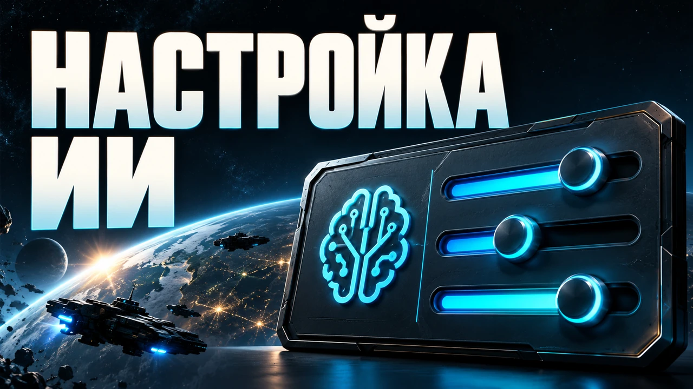
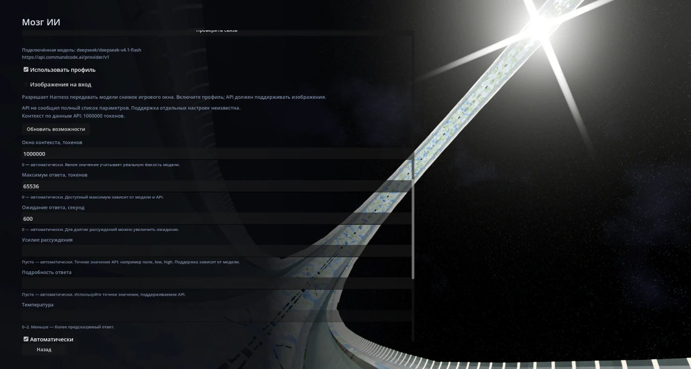
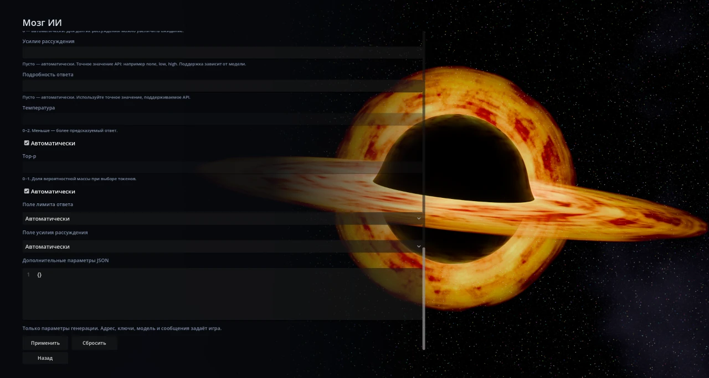

# Тонкая настройка ИИ

Настройки модели для Pax Universe: контекст, длина ответа, рассуждения и дополнительные параметры. Для каждого адреса API и модели сохраняется свой профиль.

В обычной игре мод работает **после загрузки партии**: **Настройки → Нейросеть → Дополнительно → Тонкая настройка**. В репозитории есть часть для лаунчера: в обычной игре она не работает, её нужно встроить **в форк игры** — [исходники части для форка](integrations/game-fork/).

## Установка

### Через официальную мастерскую

1. В лаунчере откройте **Мастерская**, найдите **«Тонкая настройка ИИ»** и нажмите **«Установить»**.
2. В разделе **Моды** убедитесь, что мод включён.

### Вручную из GitHub

1. Скачайте `ai_tuning-2.2.0.zip` из раздела **Releases** и закройте игру.
2. Откройте **Лаунчер → Моды → Папка модов** и поместите туда ZIP целиком. Распаковывать архив не нужно. На Windows пользовательская папка обычно находится в `%APPDATA%\Pax Universe\mods`.
3. Запустите игру и включите **«Тонкая настройка ИИ»** в разделе **Моды**.

Загрузите или начните партию и откройте **Настройки → Нейросеть → Дополнительно → Тонкая настройка**. Не устанавливайте одновременно архив и распакованную копию мода. При ручном обновлении замените прежнюю копию при закрытой игре; установка из мастерской обновляется через лаунчер.

## Как пользоваться

Выберите подключение и модель штатными средствами игры. Откройте **Настройки → Нейросеть → Дополнительно → Тонкая настройка**, включите «Использовать профиль», задайте параметры и нажмите **«Применить»**. «Сбросить» удаляет профиль выбранной модели. Профили сохраняются отдельно от партий.

| Настройка | Что меняет |
| --- | --- |
| Окно контекста | Сколько токенов вмещает запрос вместе с ответом. |
| Максимум ответа | Сколько токенов модель может выдать за один запрос. |
| Ожидание ответа | Сколько секунд ждать завершения запроса. |
| Усилие рассуждения | Точное значение reasoning, которое поддерживает ваша модель: например `none`, `low`, `high`. |
| Подробность ответа | Значение verbosity, если оно поддерживается API. |
| Температура | Разнообразие ответа: меньше — предсказуемее. |
| Top-p | Доля вероятностной массы при выборе следующего токена. |
| Изображения на вход | Разрешает Harness передавать модели снимок игрового окна. Включайте только для API и модели, которые принимают изображения. |
| Дополнительный JSON | Другие параметры генерации вашего API. |

Ноль, пустое поле или «Автоматически» оставляют соответствующую настройку игре. «Обновить возможности» запрашивает сведения о выбранной модели; некоторые API сообщают их не полностью. Значения и допустимые пределы зависят от модели. Поля выбора API обычно можно оставить в `auto`.

В JSON задавайте параметры генерации. Адрес, ключ, модель и сообщения остаются в штатном подключении игры. Например: `{"seed":42}` — если ваш API поддерживает `seed`. Ключи в профили не копируются.

Снимки Harness доступны при включённых «Использовать профиль» и «Изображения на вход» для выбранного адреса и модели. Флаг сам по себе не добавляет зрение текстовой модели.

Мод работает самостоятельно и вместе с Pax Harness 1.10.0+. Версия мода: **2.2.0**. Проверенная версия игры: **Pax Universe 0.31.4**.

## В игре

[Открыть скриншот в полном размере](media/settings.webp)

